# Entity-Relationship Diagram (core + metadata layer)

Rendered automatically on GitHub / VS Code / any Mermaid viewer. Generated from the same schema definition as the DDL.

```mermaid
erDiagram
    dim_company {
        smallint company_id PK
        varchar company_name
        varchar company_group
        enum company_type
        tinyint is_placeholder_employer
    }
    dim_job_title {
        tinyint job_title_id PK
        varchar job_title
        varchar base_role
        enum seniority
    }
    dim_city {
        smallint city_id PK
        varchar city_name
        enum city_category
    }
    dim_role_family {
        tinyint role_family_id PK
        varchar role_family
        tinyint is_analytics
    }
    dim_seniority {
        tinyint seniority_id PK
        varchar seniority
        tinyint seniority_rank
    }
    dim_salary_band {
        tinyint salary_band_id PK
        varchar band_code
        varchar band_label
        decimal low_lpa
        decimal high_lpa
    }
    dim_skill {
        smallint skill_id PK
        varchar skill_name
        enum skill_type
    }
    dim_skill_dimension {
        tinyint dimension_id PK
        varchar dimension_code
        varchar dimension_name
        varchar jds_score_column
    }
    map_skill_dimension {
        smallint skill_id PK,FK
        tinyint dimension_id PK,FK
    }
    dim_personality_trait {
        tinyint trait_id PK
        varchar trait_code
        varchar trait_name
        varchar description
    }
    fact_company_job_title {
        int company_job_title_id PK
        int reference_no
        smallint company_id FK
        tinyint job_title_id FK
        tinyint min_experience_years
        decimal min_salary_lpa
        decimal avg_salary_lpa
        decimal max_salary_lpa
        int num_of_jobs
        tinyint is_min_salary_implausible
        tinyint is_wide_salary_range
        tinyint is_senior_zero_exp
        tinyint is_num_jobs_outlier
        tinyint is_salary_outlier_in_title
    }
    fact_job_posting {
        int posting_id PK
        varchar job_title_raw
        varchar job_title_clean
        tinyint role_family_id FK
        enum role_source
        tinyint seniority_id FK
        tinyint exp_min_years
        tinyint exp_max_years
        tinyint salary_band_id FK
        smallint primary_city_id FK
        varchar location_raw
        text job_description
        tinyint is_job_type_tagged
        tinyint is_desc_missing
        tinyint is_desc_truncated
        tinyint is_skills_truncated
        tinyint is_near_duplicate
        tinyint is_possible_repost
        tinyint is_spam
        tinyint is_international
        tinyint is_salary_exp_inconsistent
    }
    bridge_posting_city {
        int posting_id PK,FK
        smallint city_id PK,FK
        tinyint city_order
    }
    bridge_posting_skill {
        int posting_id PK,FK
        smallint skill_id PK,FK
        enum found_in
    }
    jds_employee {
        smallint jds_employee_id PK
        int source_id
        tinyint salary_hike_high
    }
    fact_jds_skill_score {
        smallint jds_employee_id PK,FK
        tinyint dimension_id PK,FK
        decimal score
    }
    sds_employee {
        smallint sds_employee_id PK
        int source_id
        tinyint success_high
    }
    fact_sds_trait_score {
        smallint sds_employee_id PK,FK
        tinyint trait_id PK,FK
        smallint score
    }
    meta_data_quality_log {
        smallint issue_id PK
        varchar stage
        varchar source_file
        varchar issue_found
        int rows_affected
        varchar treatment
    }
    dim_skill ||--o{ map_skill_dimension : "skill_id"
    dim_skill_dimension ||--o{ map_skill_dimension : "dimension_id"
    dim_company ||--o{ fact_company_job_title : "company_id"
    dim_job_title ||--o{ fact_company_job_title : "job_title_id"
    dim_role_family ||--o{ fact_job_posting : "role_family_id"
    dim_seniority ||--o{ fact_job_posting : "seniority_id"
    dim_salary_band ||--o{ fact_job_posting : "salary_band_id"
    dim_city ||--o{ fact_job_posting : "primary_city_id"
    fact_job_posting ||--o{ bridge_posting_city : "posting_id"
    dim_city ||--o{ bridge_posting_city : "city_id"
    fact_job_posting ||--o{ bridge_posting_skill : "posting_id"
    dim_skill ||--o{ bridge_posting_skill : "skill_id"
    jds_employee ||--o{ fact_jds_skill_score : "jds_employee_id"
    dim_skill_dimension ||--o{ fact_jds_skill_score : "dimension_id"
    sds_employee ||--o{ fact_sds_trait_score : "sds_employee_id"
    dim_personality_trait ||--o{ fact_sds_trait_score : "trait_id"
```

**Staging layer** (raw copies, no relationships, kept for audit):

- `stg_datascience_jobs` (1,602 rows) - Original 'DataScience Jobs.csv' exactly as received (salaries still text, e.g. '7.8L')
- `stg_analytics_jobs` (15,841 rows) - Original 'Analytics Jobs.csv' exactly as received (incl. the 1,001 exact duplicates)
- `stg_jds_skill_traits` (139 rows) - Original 'JDS Skill Traits.xlsx' (column maths-stats_skills renamed maths_stats_skills)
- `stg_sds_personality_traits` (161 rows) - Original 'SDS Personality Traits.xlsx' (stray spaces removed from column names)
