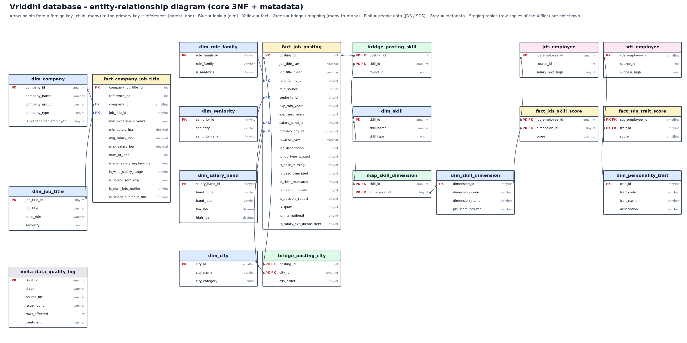

# Vriddhi MySQL database

**Database:** `vriddhi` · MySQL 8 · InnoDB · utf8mb4
**Built by:** `build_database.py` (from the cleaned data) · **Loaded by:** `load_to_mysql.py` · **Verified by:** `sql/05_verify.sql`



## 1. Three layers (industry-standard layout)

| Layer | Tables | Purpose |
|---|---|---|
| **Staging** `stg_*` | 4 tables, 17,743 rows | The 4 original files loaded **exactly as received** (incl. duplicates, text salaries). Audit trail: any cleaned value can be traced back to its source row. |
| **Core** `dim_*`, `fact_*`, `bridge_*`, `map_*`, `jds_*`, `sds_*` | 18 tables | Cleaned data in **third normal form**, with primary keys, foreign keys, unique keys, CHECK constraints and column comments. |
| **Metadata** `meta_*` | 1 table | Data-quality log: every issue found, rows affected, treatment. |
| **Views** `v_*` | 8 views | Analysis-ready, denormalised tables. Derived values (mid-points, z-scores, sample flags, skill-dimension flags) are **computed here, never stored**. |

## 2. Core tables (what each one is)

| Table | Rows | One row is… |
|---|---|---|
| `dim_company` | 642 | a recruiting company (with `company_group`, type, placeholder flag) |
| `dim_job_title` | 10 | a job title from DataScience Jobs (base role + seniority) |
| `fact_company_job_title` | 1,602 | a company × job title offer: experience, min/avg/max salary, openings |
| `fact_job_posting` | 14,840 | an Analytics Jobs posting (exact duplicates removed) |
| `dim_role_family` | 23 | a role family (22 + Other), flagged analytics or not |
| `dim_seniority` | 5 | Entry → Leadership |
| `dim_salary_band` | 6 | a salary band (0-3 … 25-50 LPA) |
| `dim_city` | 679 | a canonical city / metro area, with tier |
| `bridge_posting_city` | 17,774 | posting × city (a posting can list several cities) |
| `dim_skill` | 8,301 | a distinct skill/tag, typed technical / soft / education / job meta |
| `bridge_posting_skill` | 81,279 | posting × skill, and where it was found (key skills / description / both) |
| `dim_skill_dimension` | 5 | big data · maths & stats · coding · AI & ML · dashboards & storytelling |
| `map_skill_dimension` | 470 | which market skills belong to which dimension (the taxonomy) |
| `jds_employee` / `fact_jds_skill_score` | 139 / 695 | a junior data scientist / their score on each of the 5 dimensions |
| `sds_employee` / `fact_sds_trait_score` | 161 / 805 | a senior data scientist / their score on each Big Five trait |
| `dim_personality_trait` | 5 | a Big Five trait with its meaning |

**The key idea:** `dim_skill_dimension` is shared by the market data (through `map_skill_dimension` → `bridge_posting_skill`) and the people data (through `fact_jds_skill_score`). That is how four files with no common key are linked — view `v_market_vs_success` shows market demand and JDS scores side by side for each dimension.

## 3. Normalisation — how and why

| Normal form | Rule | What we did in this data |
|---|---|---|
| **1NF** – atomic values, no repeating groups | One value per cell | `key_skills` ("SAS, Python, SQL, …") and `location` ("Bengaluru, Chennai") held lists → split into `bridge_posting_skill` and `bridge_posting_city`. JDS's five score columns and SDS's five trait columns are a repeating group → one row per person × dimension / trait (`fact_jds_skill_score`, `fact_sds_trait_score`). |
| **2NF** – no partial dependency on part of a composite key | Every non-key column depends on the *whole* key | In `bridge_posting_skill (posting_id, skill_id)` only `found_in` is stored — the skill's name and type depend on `skill_id` alone, so they live in `dim_skill`. Same for `bridge_posting_city` → `dim_city`. |
| **3NF** – no transitive dependency | Non-key columns depend only on the key | Company type depends on the company, not on the offer → `dim_company`. Band bounds (10 and 15 LPA) depend on the band → `dim_salary_band`. "Is this an analytics role?" depends on the role family → `dim_role_family`. Experience mid-point, salary mid-point, z-scores and sample flags are derivable → computed in views, not stored. |

**Keys:** surrogate integer keys everywhere. The original ids are kept as plain columns (`reference_no`, `source_id`) because they are **not unique** in the source.
**Integrity:** 16 foreign keys, 10 unique keys, 9 CHECK constraints (e.g. `min_salary ≤ avg_salary ≤ max_salary`, `score BETWEEN 1 AND 5`, `exp_max ≥ exp_min`), `NOT NULL` wherever the data is complete. All of these were also checked in Python before any SQL was written.

## 4. Views (use these for analysis)

| View | Gives you |
|---|---|
| `v_company_job_title` | DataScience Jobs, readable, with spread, range ratio, log openings, sample flag |
| `v_job_posting` | Every posting with role family, seniority, experience mid, salary band & mid, city, tier, and the sample flags `in_india_sample`, `in_core_analytics`, `in_salary_model` |
| `v_posting_skill` | Posting × skill with skill type and source |
| `v_posting_dimension` | Posting × the 5 dimension flags (0/1) |
| `v_skill_demand_core` | Skill demand across the 5,127 core analytics postings |
| `v_jds_wide` / `v_sds_wide` | The people data back in wide form (SDS with z-scores) |
| `v_market_vs_success` | Per dimension: share of postings that ask for it vs mean JDS score of high- and low-hike juniors |

## 5. How to load it

### Option A — local MySQL (recommended during the competition)
MySQL Server 8.0 and Workbench are already installed on this laptop.

**Workbench:** File → Run SQL Script → run `sql/01_create_schema.sql`, `02_load_staging.sql`, `03_load_core.sql`, `04_views.sql` in that order, then open `05_verify.sql` and execute it — every row should say PASS / actual = expected.

**Or Python (does all of it + verification):**
```
pip install pymysql
copy .env.example .env      (then put your MySQL user/password in .env)
python load_to_mysql.py
```

**EER diagram in Workbench (great for the report):** Database → Reverse Engineer → select `vriddhi` → it draws the official EER diagram from the live database.

### Option B — Railway (online)
> ⚠️ The hackathon rules say *"No e-mail access or data transfers to outside world during night or day."* Uploading the competition data to an online database is a data transfer outside. **Get the organisers' OK first.**

1. In Railway, create a project → **Add a MySQL database**.
2. Open the MySQL service → **Variables** → copy `MYSQL_PUBLIC_URL`.
3. Put it in `.env` as `MYSQL_URL=...` (and remove the local lines).
4. `python load_to_mysql.py` — it detects the hosted database name (e.g. `railway`) and loads everything there, then prints the verification.

## 6. Files

| File | Contents |
|---|---|
| `sql/01_create_schema.sql` | DDL: database, 23 tables, keys, constraints, comments |
| `sql/02_load_staging.sql` | Raw data (4 staging tables) |
| `sql/03_load_core.sql` | Clean, normalised data (core + metadata) |
| `sql/04_views.sql` | 8 analysis views |
| `sql/05_verify.sql` | Post-load checks with expected values |
| `csv/` | Every table as CSV (same content as the SQL) |
| `ERD.png`, `ERD.md` | ER diagram (image + Mermaid) |
| `SCHEMA.md` | Every table and column: type, key, nullability, description |
